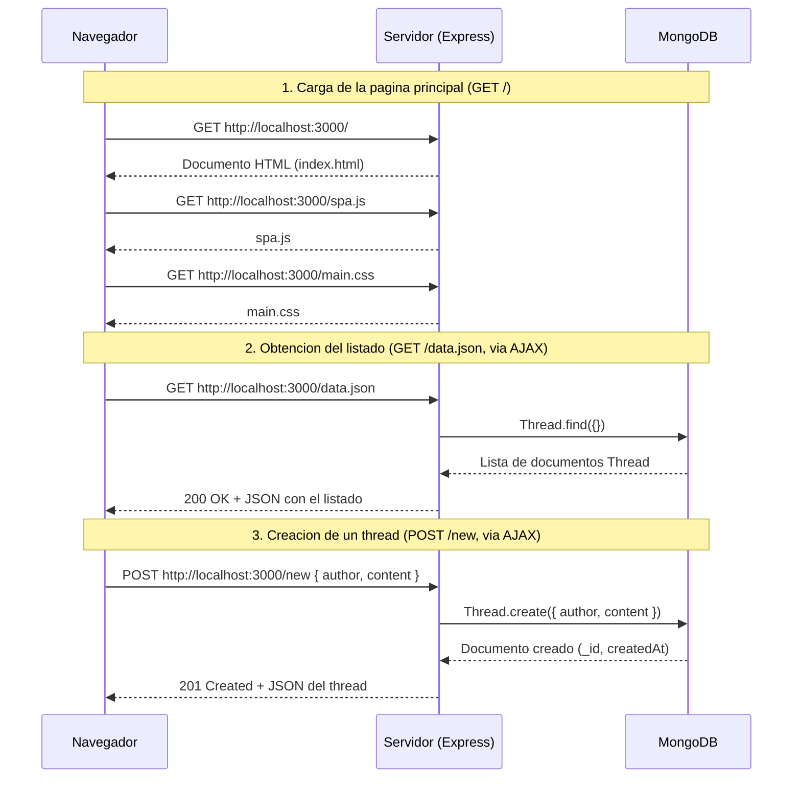

# Laboratorio 2 — Esenciales de la Web
### CC5003 · Solución explicada — Listado de threads con Node.js, Express, MongoDB y mongoose

Este documento explica, pregunta por pregunta, la solución implementada para el Laboratorio 2. El objetivo del laboratorio es construir una aplicación web "a la antigua": un servidor Express que renderiza una página, expone una API JSON respaldada por MongoDB (a través de mongoose), y un frontend que consume esa API con AJAX para comportarse como una SPA (sin recargar la página). Se resolvieron las preguntas P1 a P6 del enunciado, y además se corrigió un detalle necesario para que el servidor efectivamente funcione (ver nota al final de P4).

---

## P1 — Esquema y modelo de Thread

**Enunciado:** crear el esquema y modelo de `Thread` en `src/models/Thread.ts`, con `author` y `content` obligatorios, y la fecha de creación generada automáticamente por el servidor.

### Solución

```ts
// src/models/Thread.ts
import mongoose from "mongoose";

export interface IThread {
  author: string;
  content: string;
  createdAt: Date;
  updatedAt: Date;
}

const threadSchema = new mongoose.Schema<IThread>({
  author: { type: String, required: true },
  content: { type: String, required: true },
}, { timestamps: true });

const Thread = mongoose.model<IThread>("Thread", threadSchema);
export default Thread;
```

### Explicación

Un esquema de mongoose (`mongoose.Schema`) describe la forma de los documentos que se guardarán en una colección de MongoDB: qué campos existen, de qué tipo son y qué reglas de validación deben cumplir. Aquí se definen dos campos:

- `author: { type: String, required: true }` — el nombre del autor debe ser un string y es obligatorio. Si se intenta crear un `Thread` sin autor, mongoose lanza un `ValidationError` antes de tocar la base de datos.
- `content: { type: String, required: true }` — mismo tratamiento para el contenido del thread.

El segundo argumento del `Schema`, `{ timestamps: true }`, le indica a mongoose que agregue automáticamente dos campos a cada documento: `createdAt` (fecha de creación) y `updatedAt` (fecha de última modificación). mongoose los administra internamente cada vez que se crea o guarda un documento, por lo que nunca deben enviarse desde el navegador: eso es justamente lo que pide el enunciado ("la fecha debe asignarse automáticamente desde el servidor").

La interfaz `IThread` es la contraparte en TypeScript: le dice al compilador qué forma tiene un documento `Thread` (`author`, `content`, y las fechas `createdAt`/`updatedAt` que agrega `timestamps`). Al pasarla como parámetro genérico de `mongoose.Schema<IThread>` y `mongoose.model<IThread>(...)`, TypeScript puede revisar en tiempo de compilación que el resto del código (por ejemplo, `thread.author` o `thread.createdAt` en el frontend/backend) use los campos correctos, y avisa si se intenta acceder a un campo que no existe.

---

## P2 — Ruta GET /data.json

**Enunciado:** implementar `GET /data.json`, que entregue en JSON todos los threads almacenados en la base de datos.

### Solución

```ts
// src/routes/threadRoute.ts
router.get("/data.json", async (req, res) => {
  try {
    const threads = await Thread.find();
    return res.json(threads);
  } catch (error) {
    console.error("Error encontrando threads:", error);
    return res.status(500).json({ error: "Error interno del servidor" });
  }
});
```

### Explicación

`Thread.find()` (equivalente a `Thread.find({})`) le pide a MongoDB todos los documentos de la colección `threads`, sin filtro. Es una operación asíncrona: se comunica con el proceso de MongoDB por red, así que hay que esperar su respuesta con `await` antes de continuar. Mientras se espera, Node.js sigue atendiendo otras peticiones (el event loop no se bloquea).

`res.json(threads)` serializa el arreglo de documentos a JSON y agrega automáticamente el header `Content-Type: application/json`, que es lo que el frontend espera para poder hacer `response.json()` en el `fetch`. El bloque `try/catch` captura cualquier error de conexión o de consulta a MongoDB y responde con un 500, en vez de dejar que la excepción tumbe el servidor o cuelgue la petición.

---

## P3 — Página principal y visualización (SPA)

**Enunciado:** implementar `GET /`, que entregue el HTML de la página, y hacer que ese HTML pida el listado por AJAX a `/data.json` y lo muestre, sin recargar la página.

### Solución — ruta GET /

```ts
// src/routes/threadRoute.ts
router.get("/", (req, res) => {
  return res.sendFile(path.join(__dirname, "../../public/index.html"));
});
```

### Solución — public/index.html (extracto)

```html
<div class="container">
  <h1>Listado de threads</h1>
  <form id="new-thread-form"> ... </form>
  <ul id="threads" class="threads"></ul>
</div>
<script src="/spa.js"></script>
```

### Solución — public/spa.js (carga del listado)

```js
async function loadThreads() {
  const response = await fetch("/data.json");
  const threads = await response.json();
  threadsList.innerHTML = "";
  threads.forEach(renderThread);
}

loadThreads(); // se ejecuta apenas carga spa.js
```

### Explicación

La ruta `GET /` no arma el HTML con los datos incrustados (como haría un servidor "render en el servidor" tradicional): simplemente entrega el archivo estático `index.html` con `res.sendFile`. Todo el contenido dinámico (el listado de threads) se agrega después, en el navegador, mediante JavaScript. Esa es la diferencia clave entre una página clásica y una SPA: la navegación inicial trae un HTML "vacío" (solo estructura) y luego el propio JavaScript va pidiendo datos y actualizando el DOM.

`spa.js` implementa esa lógica: la función `loadThreads()` usa `fetch("/data.json")` para pedir el listado en formato JSON (una petición AJAX: *Asynchronous JavaScript And XML*, aunque hoy en día casi siempre se usa JSON en vez de XML). `response.json()` convierte el cuerpo de la respuesta a un arreglo de objetos JavaScript, y `renderThread(thread)` crea los elementos `<li>` del listado con `document.createElement` y los agrega al DOM. Como todo esto ocurre después de que la página ya cargó, y sin usar formularios con submit tradicional ni `location.href`, el navegador nunca recarga: por eso se cumple el requisito de SPA.

Un detalle de seguridad: `renderThread` usa `element.textContent` en vez de `element.innerHTML` para insertar el autor y el contenido escritos por el usuario. Si se usara `innerHTML`, un autor podría escribir texto como `` y el navegador lo interpretaría como HTML real (un ataque de tipo XSS). `textContent` siempre trata el valor como texto plano, nunca como marcado.

---

## P4 — Ruta POST /new

**Enunciado:** implementar `POST /new`, que reciba `author` y `content`, cree un `Thread` y lo guarde en la base de datos, retornando el thread creado en JSON. La fecha no se recibe por esta ruta: la genera el modelo (P1).

### Solución

```ts
// src/routes/threadRoute.ts
router.post("/new", async (req, res) => {
  try {
    const { author, content } = req.body;
    const thread = await Thread.create({ author, content });
    return res.status(201).json(thread);
  } catch (error) {
    console.error("Error creando thread:", error);
    return res.status(500).json({ error: "Error interno del servidor" });
  }
});
```

### Explicación

`req.body` contiene el cuerpo de la petición ya parseado como objeto JavaScript, gracias al middleware `express.json()` registrado en `src/app.ts` (`app.use(express.json())`): sin ese middleware, `req.body` sería `undefined` y habría que parsear el JSON manualmente. Se desestructuran solo `author` y `content` de ese objeto — deliberadamente no se toma ninguna fecha del body, aunque el cliente la enviara, porque no se usa: `createdAt` lo genera mongoose automáticamente al crear el documento (opción `timestamps` de P1).

`Thread.create({ author, content })` hace dos cosas en un solo paso: valida los datos contra el esquema (si falta `author` o `content`, mongoose lanza un error de validación que cae en el `catch`) y, si son válidos, guarda el documento en MongoDB. El objeto que retorna ya incluye el `_id` que asignó MongoDB y las fechas `createdAt`/`updatedAt`. Se responde con status `201` (*Created*), el código HTTP estándar para "se creó un recurso nuevo", junto con ese documento en JSON.

**Nota técnica sobre la conexión al servidor:** al revisar `src/app.ts` se detectó que el archivo no llamaba a `app.listen(...)`, por lo que el servidor de Express nunca quedaba escuchando en el puerto 3000 (`npm run dev` no fallaba, pero `http://localhost:3000` no respondía). Se agregó ese llamado al final del archivo, sin tocar el bloque de conexión a MongoDB que el enunciado pide no modificar:

```ts
// src/app.ts (agregado)
const PORT = 3000;
app.listen(PORT, () => {
  console.log(`Servidor escuchando en http://localhost:${PORT}`);
});
```

Se verificó localmente que, con este cambio, el servidor efectivamente levanta y responde en el puerto 3000 (se probaron `GET /`, `GET /spa.js` y `GET /main.css`). También se compiló todo el proyecto con `npx tsc --noEmit` sin errores, confirmando que los tipos de `IThread` encajan con el resto del código.

---

## P5 — Formulario de creación (AJAX)

**Enunciado:** agregar a la página principal un formulario que pida autor y contenido, enviarlo por AJAX a `POST /new`, y agregar el thread creado al listado sin recargar la página.

### Solución — formulario (public/index.html)

```html
<form id="new-thread-form">
  <label for="author">Autor</label>
  <input type="text" id="author" name="author" required />
  <label for="content">Contenido</label>
  <textarea id="content" name="content" required></textarea>
  <button type="submit">Publicar</button>
</form>
```

### Solución — envío por AJAX (public/spa.js)

```js
newThreadForm.addEventListener("submit", async (event) => {
  event.preventDefault();

  const author = document.getElementById("author").value;
  const content = document.getElementById("content").value;

  const response = await fetch("/new", {
    method: "POST",
    headers: { "Content-Type": "application/json" },
    body: JSON.stringify({ author, content }),
  });

  if (!response.ok) return;

  const thread = await response.json();
  renderThread(thread);
  newThreadForm.reset();
});
```

### Explicación

`event.preventDefault()` es la línea clave para que esto sea una SPA: por defecto, al hacer submit en un formulario HTML, el navegador arma una petición y navega a la respuesta (recargando la página). `preventDefault()` cancela ese comportamiento nativo, dejando el control totalmente en manos del código JavaScript.

En vez de eso, se lee el valor de los campos (`author`, `content`) y se hace un `fetch` manual con `method: "POST"`, indicando en el header `Content-Type: application/json` que el cuerpo va en formato JSON, y convirtiendo el objeto `{ author, content }` a texto con `JSON.stringify` (que es lo que espera el middleware `express.json()` del servidor para poder poblar `req.body` en P4).

Cuando la respuesta llega, `response.json()` entrega el thread ya creado (con su `_id` y `createdAt` reales, generados por el servidor), y `renderThread(thread)` lo agrega directamente al final del listado en el DOM, sin volver a pedir todo `/data.json` ni recargar la página. Finalmente, `newThreadForm.reset()` limpia los campos del formulario para dejarlo listo para un próximo thread.

---

## P6 — Diagrama secuencial

**Enunciado:** diagramar la cadena de eventos entre navegador, servidor y MongoDB para `GET /`, `GET /data.json` y `POST /new`.



### Explicación

El diagrama sigue el mismo formato que el ejemplo del enunciado (navegador arriba a la izquierda, servidor al centro), agregando MongoDB como tercer participante porque dos de los tres flujos requieren hablar con la base de datos:

- **GET / y los recursos estáticos** (`spa.js`, `main.css`): son puramente Navegador ↔ Servidor. Express responde directamente con archivos del disco (`res.sendFile` o el middleware `express.static`), sin consultar MongoDB.
- **GET /data.json**: el navegador pide el listado por AJAX; el servidor reenvía la consulta a MongoDB con `Thread.find({})`, espera la lista de documentos, y recién ahí responde al navegador con el JSON.
- **POST /new**: el navegador envía `{ author, content }` por AJAX; el servidor le pide a MongoDB que cree el documento con `Thread.create(...)` (lo que además dispara la validación del esquema y genera `_id` y `createdAt`), y responde al navegador con el thread ya persistido.

El punto pedagógico central del diagrama es mostrar que, en las dos últimas requests, el servidor actúa como intermediario: nunca es el navegador el que habla directamente con MongoDB (por seguridad y porque MongoDB no expone una API HTTP pensada para eso). El navegador solo conoce la API REST del servidor Express; es el servidor el que sabe cómo traducir esas peticiones a operaciones de mongoose.

---

## Cómo ejecutar y probar

- Ejecutar `npm install` en la carpeta del proyecto.
- Iniciar MongoDB local (`mongod`) en su computador.
- Ejecutar `npm run dev` y abrir `http://localhost:3000`.
- Verificar: la página muestra el listado (vacío al inicio), se puede crear un thread con el formulario y aparece de inmediato en la lista sin recargar; al refrescar manualmente el navegador (F5), el thread creado sigue apareciendo porque ya quedó guardado en MongoDB.

**Nota:** se detectó que el nombre de la base de datos en `src/app.ts` (`notesdb`) no coincide con el que menciona el README (`cc5003-lab-2`). Como el enunciado indica no modificar el bloque de conexión, se dejó tal cual; funcionalmente no afecta a ninguna de las preguntas P1-P6, ya que ambas son bases de datos locales válidas — es solo un detalle de nombre que puede comentarse con el ayudante si genera dudas.
